Part 2 do projeto...

# Sistema de Gestão de Condomínio

<h1 align="center">Grupo POO N1 - 7</h1>

  Gabriel Andrade, Gabriel Ribeiro, Guilherme Bernardese e Erick Gabriel.

## 1. Objetivo do Projeto

Desenvolver um sistema para auxiliar na administração do condomínio, centralizando informações e facilitando processos como controle de acesso, reservas de áreas comuns, manutenção, comunicação e gestão administrativa e financeira.

O sistema busca facilitar a comunicação entre moradores e administração, melhorar o controle das atividades internas e organizar os principais serviços disponibilizados pelo condomínio.

## 2. Identificação dos Módulos Iniciais

Os módulos representam as principais funcionalidades do sistema e estão organizados em agrupamentos lógicos, de acordo com suas responsabilidades.

### 2.1. Gestão de Acesso e Portaria

**Módulo 1 – Controle de Visitantes**
- Cadastro e identificação de visitantes.
- Autorização de visitantes pelos moradores.
- Registro de entrada e saída.

**Módulo 2 – Gestão de Encomendas**
- Registro de recebimento de encomendas.
- Identificação da unidade destinatária.
- Registro de retirada de encomendas.

**Módulo 3 – Registro de Ocorrências da Portaria**
- Registro de problemas relacionados ao acesso.
- Registro de situações envolvendo visitantes.
- Acompanhamento de ocorrências da portaria.

### 2.2. Gestão de Áreas Comuns e Lazer

**Módulo 4 – Gestão de Espaços Comuns**
- Cadastro de espaços compartilhados.
- Consulta das áreas disponíveis.
- Informações sobre capacidade e regras de utilização.

**Módulo 5 – Reservas de Áreas Comuns**
- Solicitação de reservas.
- Consulta de disponibilidade.
- Aprovação e cancelamento de reservas.

### 2.3. Gestão de Garagem

**Módulo 6 – Gestão de Veículos e Vagas**
- Cadastro e identificação de veículos.
- Consulta de vagas.
- Controle de utilização das vagas.

### 2.4. Gestão de Manutenção e Infraestrutura

**Módulo 7 – Solicitações de Manutenção**
- Abertura de solicitações de reparos.
- Registro de problemas nas áreas comuns.
- Acompanhamento do andamento das solicitações.

**Módulo 8 – Gestão de Serviços e Reparos**
- Registro de serviços executados.
- Atualização do status das manutenções.
- Histórico de serviços realizados.

### 2.5. Gestão Administrativa

**Módulo 9 – Gestão de Moradores e Unidades**
- Cadastro de moradores.
- Cadastro de unidades residenciais.
- Gerenciamento dos vínculos entre moradores e unidades.

**Módulo 10 – Gestão de Funcionários**
- Cadastro de funcionários.
- Gerenciamento de cargos e responsabilidades.
- Consulta de informações dos colaboradores.

**Módulo 11 – Comunicação e Documentos**
- Publicação de comunicados.
- Disponibilização de documentos.
- Consulta de informações administrativas.

### 2.6. Gestão Financeira

**Módulo 12 – Gestão Financeira e Pagamentos**
- Consulta de taxas condominiais.
- Acompanhamento de pagamentos.
- Consulta de despesas e inadimplência.
- Disponibilização de informações financeiras.

**Total: 12 módulos iniciais organizados em 6 agrupamentos lógicos.**

## 3. Personas e Perfis de Acesso

As personas representam os diferentes perfis de usuários que interagem com o sistema. Cada perfil possui responsabilidades e permissões específicas, de acordo com sua função dentro do condomínio.

### 3.1. Proprietário

Possui uma unidade no condomínio e pode consultar informações relacionadas ao imóvel, autorizar visitantes, realizar reservas e acompanhar informações financeiras.

**Principais acessos:**
- Consultar informações da unidade.
- Autorizar visitantes.
- Consultar encomendas.
- Reservar áreas comuns.
- Consultar taxas e pagamentos.
- Consultar documentos e comunicados.

### 3.2. Inquilino

Reside em uma unidade alugada e utiliza os serviços disponibilizados aos moradores do condomínio.

**Principais acessos:**
- Consultar informações da unidade.
- Autorizar visitantes.
- Consultar encomendas.
- Reservar áreas comuns.
- Registrar ocorrências.
- Consultar documentos e comunicados.

### 3.3. Síndico

Responsável pela administração geral do condomínio e pela supervisão dos processos administrativos, financeiros e operacionais.

**Principais acessos:**
- Gerenciar moradores e unidades.
- Gerenciar funcionários.
- Publicar comunicados.
- Acompanhar ocorrências.
- Gerenciar reservas.
- Acompanhar solicitações de manutenção.
- Consultar relatórios financeiros.

### 3.4. Subsíndico

Auxilia o síndico na administração e executa atividades delegadas pela gestão do condomínio.

**Principais acessos:**
- Consultar ocorrências.
- Acompanhar solicitações de manutenção.
- Consultar informações da portaria.
- Executar atividades administrativas autorizadas.

### 3.5. Porteiro

Responsável pelo controle de acesso de pessoas e pelo gerenciamento de encomendas recebidas na portaria.

**Principais acessos:**
- Consultar autorizações de entrada.
- Registrar entrada e saída de visitantes.
- Registrar recebimento de encomendas.
- Vincular encomendas às unidades.
- Registrar retirada de encomendas.
- Registrar ocorrências da portaria.

### 3.6. Zelador

Responsável por acompanhar a conservação, o funcionamento e as necessidades operacionais do condomínio.

**Principais acessos:**
- Consultar solicitações de manutenção.
- Registrar necessidades de reparo.
- Acompanhar serviços executados.
- Registrar atividades de conservação.

### 3.7. Auxiliar de Serviços Gerais

Responsável por executar atividades de limpeza e conservação das áreas do condomínio.

**Principais acessos:**
- Consultar tarefas de limpeza.
- Registrar atividades realizadas.
- Informar necessidades de conservação.

### 3.8. Responsável pela Manutenção

Responsável por receber solicitações, executar ou acompanhar reparos e atualizar o andamento dos serviços.

**Principais acessos:**
- Consultar solicitações de manutenção.
- Registrar serviços executados.
- Atualizar o status das solicitações.
- Registrar problemas de infraestrutura.
- Consultar histórico de manutenções.

### 3.9. Visitante

Pessoa externa que acessa o condomínio mediante autorização de um morador e identificação na portaria.

**Participação no sistema:**
- Apresentar-se para identificação.
- Ter sua autorização de entrada consultada pela portaria.

**Observação:** o visitante não precisa necessariamente possuir uma conta ou acessar diretamente o sistema. Sua autorização é realizada pelo morador e verificada pelo porteiro.

### 3.10. Resumo dos Perfis de Acesso

| Perfil | Tipo de acesso |
|---|---|
| Proprietário | Acesso às informações da unidade e funcionalidades disponíveis aos proprietários. |
| Inquilino | Acesso às funcionalidades disponibilizadas aos moradores. |
| Síndico | Acesso administrativo e gerencial. |
| Subsíndico | Acesso administrativo conforme permissões delegadas. |
| Porteiro | Acesso às funcionalidades de portaria e controle de entrada. |
| Zelador | Acesso às funcionalidades operacionais e de conservação. |
| Auxiliar de Serviços Gerais | Acesso às tarefas de limpeza e conservação. |
| Responsável pela Manutenção | Acesso às funcionalidades de manutenção e reparos. |
| Visitante | Sem acesso direto obrigatório ao sistema. |

**Observação:** os níveis de acesso poderão ser refinados durante o desenvolvimento, conforme as necessidades e regras do condomínio.

## 4. Proposta Inicial do Diagrama de Casos de Uso

O diagrama de casos de uso representa as principais interações entre os atores e o Sistema de Gestão de Condomínio.

A proposta inicial contempla as funcionalidades identificadas nos módulos e as responsabilidades de cada perfil de usuário.

### 4.1. Atores do Sistema

- Proprietário.
- Inquilino.
- Síndico.
- Subsíndico.
- Porteiro.
- Zelador.
- Auxiliar de Serviços Gerais.
- Responsável pela Manutenção.
- Visitante.

### 4.2. Diagrama de Casos de Uso

```mermaid
flowchart TB
    subgraph Atores
        P[Proprietário]
        I[Inquilino]
        S[Síndico]
        SS[Subsíndico]
        PO[Porteiro]
        Z[Zelador]
        ASG[Auxiliar de Serviços Gerais]
        M[Responsável pela Manutenção]
        V[Visitante]
    end

    subgraph Sistema["Sistema de Gestão de Condomínio"]
        UC1([Consultar informações da unidade])
        UC2([Consultar encomendas])
        UC3([Autorizar visitantes])
        UC4([Consultar e reservar áreas comuns])
        UC5([Consultar taxas e pagamentos])
        UC6([Registrar ocorrências])
        UC7([Gerenciar moradores e unidades])
        UC8([Gerenciar funcionários])
        UC9([Gerenciar comunicados e documentos])
        UC10([Gerenciar reservas])
        UC11([Acompanhar ocorrências])
        UC12([Gerenciar solicitações de manutenção])
        UC13([Registrar entrada e saída])
        UC14([Gerenciar encomendas])
        UC15([Registrar atividades de conservação])
        UC16([Consultar tarefas de limpeza])
        UC17([Registrar serviços e reparos])
        UC18([Consultar autorizações de entrada])
        UC19([Apresentar-se para identificação])
        UC20([Consultar relatórios financeiros])
    end

    P --> UC1
    P --> UC2
    P --> UC3
    P --> UC4
    P --> UC5
    P --> UC6

    I --> UC1
    I --> UC2
    I --> UC3
    I --> UC4
    I --> UC6

    S --> UC7
    S --> UC8
    S --> UC9
    S --> UC10
    S --> UC11
    S --> UC12
    S --> UC20

    SS --> UC11
    SS --> UC12
    SS --> UC9

    PO --> UC13
    PO --> UC14
    PO --> UC18
    PO --> UC11

    Z --> UC12
    Z --> UC15

    ASG --> UC16
    ASG --> UC15

    M --> UC12
    M --> UC17

    V --> UC19
    V --> UC13
```

### 4.3. Considerações sobre o Diagrama

O diagrama apresenta uma proposta inicial das funcionalidades do sistema e dos atores envolvidos.

Proprietários e inquilinos possuem funcionalidades semelhantes, pois ambos utilizam os serviços disponibilizados aos moradores.

O síndico possui acesso às principais funcionalidades administrativas e gerenciais, enquanto o subsíndico atua conforme as permissões delegadas.

Os funcionários possuem acesso às funcionalidades relacionadas às suas responsabilidades operacionais.

O visitante participa do processo de identificação e controle de acesso, sem necessidade obrigatória de possuir uma conta no sistema.

## 5. Considerações Finais

Esta documentação apresenta a proposta inicial do Sistema de Gestão de Condomínio, contemplando seus principais módulos, agrupamentos lógicos, personas, perfis de acesso e casos de uso.

As definições apresentadas poderão ser ajustadas conforme a evolução do projeto, a identificação de novas necessidades e as decisões tomadas pela equipe durante o desenvolvimento.
